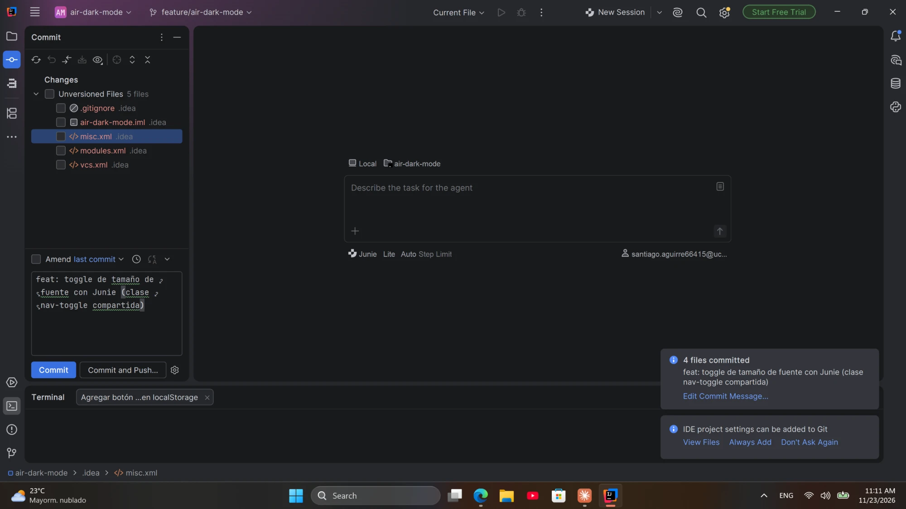
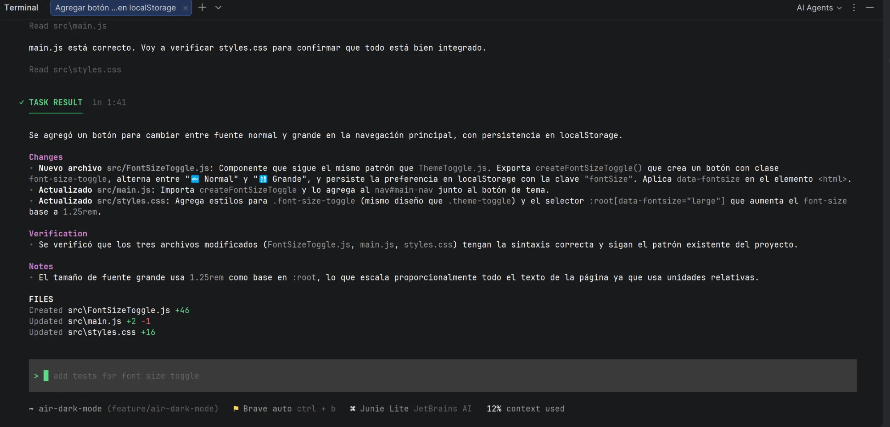
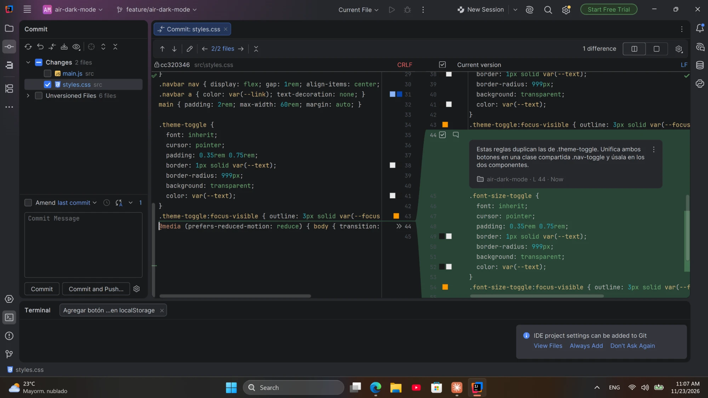
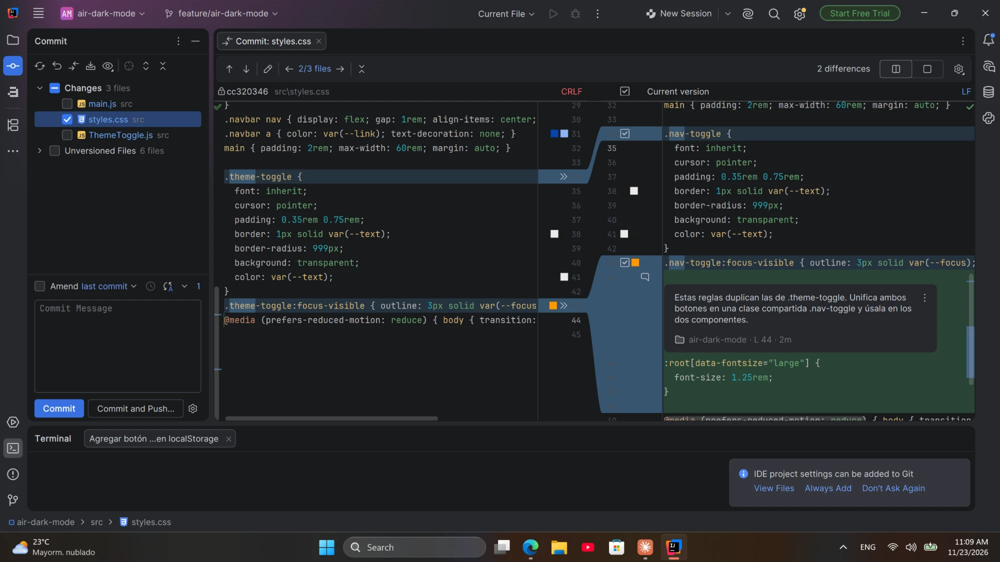

# Informe – JetBrains Air + Junie en un proyecto web (Programación Web 1)

**Autor:** Santiago Aguirre · **Rama:** `feature/air-dark-mode`
**Repositorio:** https://github.com/santiagoaguirre66415/air-dark-mode/tree/feature/air-dark-mode

## Resumen del trabajo
Proyecto base Vite (HTML/CSS/JS) con navbar. Se implementó un toggle de tema claro/oscuro (`ThemeToggle.js`, `theme.js`) con persistencia en `localStorage`, `aria-pressed` y variables CSS. Después, con el agente **Junie Lite** (JetBrains AI) en Air, se pidió un segundo botón para alternar el tamaño de fuente (`FontSizeToggle.js`) y se corrigió tras revisar el diff.

## Capturas
**1. Air conectado al agente con sesión activa**

**2. Revisión del diff: comentario en línea y ajuste aplicado**

## Flujo realizado
1. **Prueba 1:** se pidió, sin dar rutas, un botón de fuente normal/grande persistente. Junie localizó por sí sola `main.js` y `styles.css`, creó `src/FontSizeToggle.js` y siguió el patrón de `ThemeToggle.js` (misma estructura, `try/catch` en `localStorage`, `aria-pressed`).
2. **Prueba 2:** al revisar el diff de `styles.css` se vio que `.font-size-toggle` duplicaba línea por línea `.theme-toggle`. Se dejó un comentario en línea (L44) pidiendo una clase compartida. Junie unificó ambos en `.nav-toggle` (`styles.css` +2 −13; una línea cambiada en cada componente).
3. **Prueba 3:** cambios confirmados en la rama `feature/air-dark-mode` (commit `1ed613b`). `npm run build` compila sin errores y se comprobó en el navegador que el botón de tema alterna, que `aria-pressed` cambia y que la preferencia persiste tras recargar.

## 1. Solución del agente vs. convenciones del proyecto
- **Coincide:** modularidad (un componente por archivo, exporta `createXToggle()`), persistencia con respaldo si `localStorage` falla, `aria-pressed` y `aria-label`, y estilos con variables CSS.
- **No coincidía a la primera:** duplicó el CSS en lugar de reutilizar la clase existente. Se corrigió con la revisión en el diff.
- **Pendiente de mejora:** el atributo `data-fontsize` en `<html>` y el escalado en `rem` funcionan, pero la preferencia de fuente no se aplica antes de pintar la página (posible parpadeo al recargar) y no hay pruebas automáticas.

## 2. Consumo de recursos/créditos
Se usó el modelo **Junie Lite** (JetBrains AI) en dos tareas: la creación del botón (≈1:41 min, 12 % del contexto usado) y la corrección del CSS (≈0:32 min, 9 %). La sesión no mostró un contador de créditos consumidos, por lo que no se puede dar una cifra exacta; el consumo fue bajo (dos tareas cortas, pocos archivos).

## 3. Reflexión crítica: Air vs. chat desacoplado
- **Ventajas de Air:** el agente lee el proyecto sin tener que pegarle código, ubica los archivos correctos, sigue los patrones existentes y entrega los cambios como un diff revisable con comentarios en línea, integrado con Git. El ciclo comentar → corregir → revisar es mucho más corto que copiar y pegar en un chat.
- **Limitaciones:** hay que revisar siempre el diff (aquí duplicó CSS), el consumo de créditos no es transparente y depende de la conexión/cuenta (el inicio de sesión de Junie por la CLI requirió pasos extra).
- **Chat tradicional:** sirve para dudas y explicaciones, pero pierde contexto del repositorio y obliga a integrar el código a mano, con más riesgo de errores. Para tareas de implementación sobre un proyecto existente, el entorno integrado es claramente más útil; para aprender o discutir enfoques, un chat sigue siendo suficiente.
